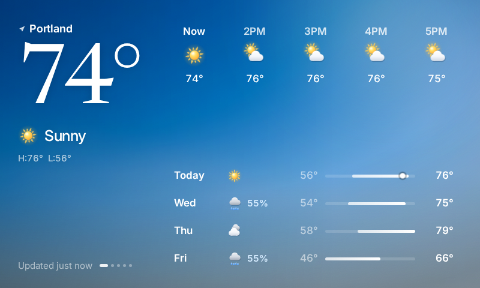
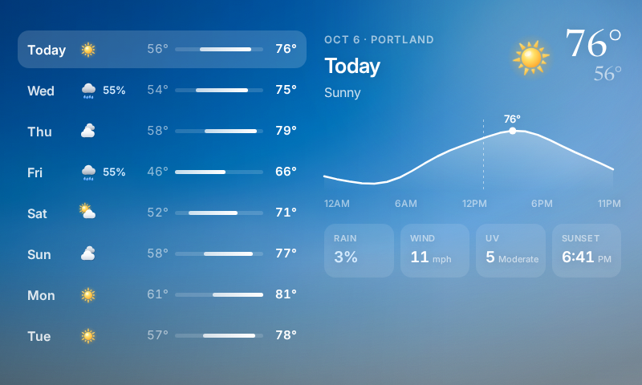
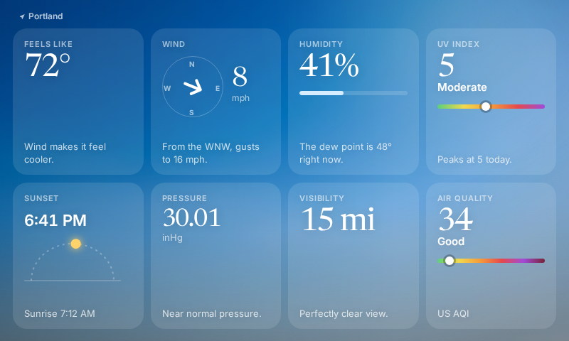
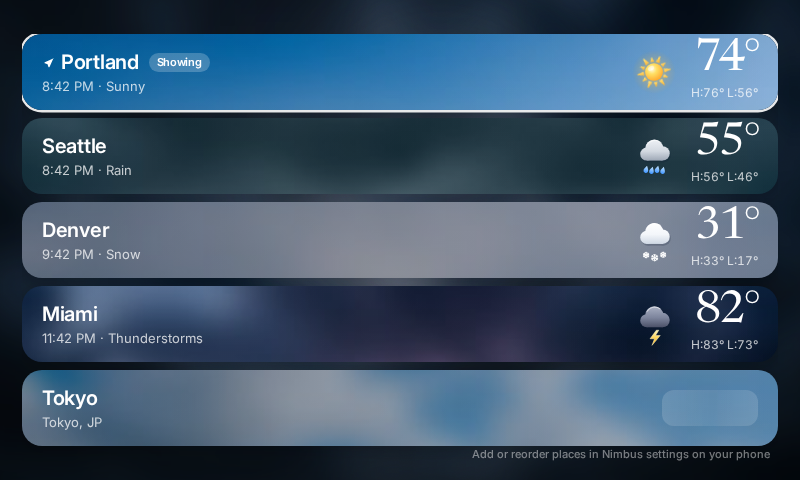

# Nimbus

A calm, animated weather app for the Spotify Car Thing running
[BridgeThing OS](https://bridgething.com). Big serif temperature, the next
hours, the week ahead, and a sky that changes with the weather and the time of day.






## How it works

```
Car Thing (Nimbus UI) ──BridgeThing daemon──▶ companion app on phone ──HTTPS──▶ Open-Meteo
                                     │
                                     └──▶ phone GPS (geo.getOnce, coarse)
```

- The Car Thing has no network of its own. Every request goes through the
  companion app with `client.net.fetch`.
- Forecasts: [Open-Meteo](https://open-meteo.com) (free, no API key):
  current conditions, hourly for 9 days, daily for 8 days, plus US AQI from
  Open-Meteo's air-quality API.
- Current location: one coarse fix from the phone (`geo` permission), named with
  BigDataCloud's free reverse geocoder. Saved cities come from the settings page.
- The last forecasts, the GPS place and the chosen place are cached in
  `client.store`, so the screen fills instantly on boot, even offline.
- Refreshes every 15 minutes, when you change place or units, and on demand.

## Screens

| Preset | Screen | What's there |
| --- | --- | --- |
| 1 | **Now** | The reference layout: place, big temperature, condition, H/L, next 5 hours, 4-day list with range bars and a "now" dot. Press 1 again to jump to the next place. |
| 2 | **Week** | 8 days. The knob picks a day; the right panel draws that day's temperature curve with the peak, plus rain chance, wind, UV and sunset. |
| 3 | **Details** | Feels like, wind compass, humidity and dew point, UV meter, sun arc, pressure, visibility, air quality. The knob switches place. |
| 4 | **Places** | Every place as a card painted with its own sky, local time and temperature. Knob or 4 to move, top button to open. |

## Controls

| Control | Action |
| --- | --- |
| Knob on Now | Scrub through the next 24 hours: the hero temperature rolls to that hour and the sky follows (it turns to night at sunset) |
| Knob elsewhere | Pick a day / switch place / pick a place |
| Top (mode) button | Refresh on Now and Details, back to now while scrubbing, open the highlighted place |
| Back | Return to now, then to the Now screen |
| Touch | Tap an hour to preview it, tap a day to open it in Week, swipe sideways to change place, tap "Updated" to refresh |

## Motion

- The backdrop is a blurred photo of the sky you actually have: clear,
  partly cloudy, overcast, rain, storm, snow, fog, clear night, cloudy night,
  and golden hour within 40 minutes of sunrise and sunset. Each night variant
  gets a darker scrim. Photos are pre-blurred 400×240 JPEGs (about 5 KB each,
  in `src/skies`, full-size originals in `art/`). They cross-fade on change and
  breathe with a slow 46-second zoom.
- Weather particles on a single 30 fps canvas: rain streaks, drizzle, snow
  with sway, twinkling stars on clear nights, drifting mist, and lightning
  flashes during storms.
- Layered SVG weather icons: a sun with a halo, tapered turning rays and a
  specular highlight; a crescent moon with craters and twinkling four-point
  stars; shaded cumulus clouds with a rim light and a cast shadow (two clouds
  drift against each other when it's overcast); teardrop rain; spinning
  six-armed snowflakes; sliding fog bands; a bolt whose flicker lights the
  storm cloud from inside. See them all at `?icons` and `?icons=night`.
- Temperature digits roll up or down when they change, rows rise in with a
  stagger, range bars grow, the day curve draws itself, the wind needle swings
  to its bearing, the sun slides along its arc, the selection pill glides with
  a spring.
- Transform and opacity only. `prefers-reduced-motion` (or `?still`) turns it off.

## Install

1. Install `Nimbus-1.0.2.zip` from the BridgeThing companion app, the same way
   as any shared webapp zip.
2. Allow location for the BridgeThing app on your phone if you want your
   current location, or open **Nimbus settings** in the companion app and add
   cities (search as you type, reorder, remove). Pick °F/°C and a 12/24-hour clock there too.

## Develop

Requires Node 20+ (or Bun).

```bash
npm install
npm run dev            # http://localhost:5173/?demo  runs on built-in sample data
npm run typecheck
npm run build          # dist/ (app) + dist/settings.html (companion settings page)
npm run share          # Nimbus-<version>.zip from dist/
```

Demo URL options: `view=week|details|places`, `place=0..4` (Portland sun,
Seattle rain, Denver snow, Miami storms, Tokyo night), `hour=0..23`,
`scrub=1..23`, `still`. In the browser, keys `1`-`4`, `m`, `Escape` and a
horizontal scroll stand in for the hardware.

To develop against a real device: `VITE_BRIDGETHING_URL=ws://<device-ip>:8891/ npm run dev`.
`bun run push` builds and installs onto a Car Thing connected over USB.

## Layout

- `src/App.tsx` - state, data loading, GPS, caching, controls
- `src/views.tsx` - Now, Week, Details, Places, skeleton
- `src/components.tsx` - sky, particles, rolling digits, range bars, tab marks
- `src/icons.tsx` - animated weather icons and UI glyphs
- `src/weather.ts` - Open-Meteo client, parsing, formatting
- `src/theme.ts` - sky palettes
- `src/demo.ts` - sample data for `?demo`
- `settings/` - companion settings page (Preact, single-file build)
- `public/manifest.json` - id, name, icon, config keys, permissions (`net.fetch`, `geo`)

Bump `version` in `public/manifest.json` (and `APP_VERSION` in `src/weather.ts`)
for a release. Never change the manifest `id`.

Fonts: Newsreader and Inter, both SIL Open Font License (see `src/fonts`).
Weather data by Open-Meteo.com, CC BY 4.0.
